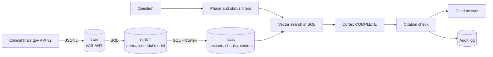

# Clinical trials assistant on Snowflake

[](https://github.com/vitaliy-antoshchenko/clinical-trials-rag-snowflake/actions/workflows/ci.yml)

A reference implementation by [Owlab](https://owlab.group) of an AI assistant that answers questions
about clinical trials from data held in Snowflake.

Registry records are loaded raw, normalised with SQL, split and embedded with Snowflake Cortex, and
searched with phase and status filters applied in SQL before vector ranking. A Cortex LLM writes the
answer with NCT citations, and code checks those citations before the answer is returned: a citation
to a trial the model was not given, or a claim with no citation, is flagged. Data, embeddings,
prompts and answers stay inside the Snowflake account.

It runs on public ClinicalTrials.gov data, so anyone can reproduce it end to end. Our client code is
private, so this repository shows the approach on open data.

## Example

A real run against 500 non-small cell lung cancer trials (Phase 1 to 3, started 2019 or later) (Cortex `claude-sonnet-5-5`, embeddings
`snowflake-arctic-embed-m-v1.5`). "Phase 3" in the question became a SQL filter, so only Phase 3
records were searched:

```text
$ ctrag ask "Which Phase 3 trials compare a new EGFR inhibitor with osimertinib?"

- NCT06970639 (Phase 3, recruiting) is the only record that fits. It compares furmonertinib plus
  platinum-based doublet chemotherapy against osimertinib in EGFR-mutation-positive non-squamous
  NSCLC with brain metastases [NCT06970639]. The excerpt does not call furmonertinib an EGFR
  inhibitor or say it is new, so that classification is an inference from the trial's EGFR focus
  [NCT06970639].

- NCT06486142 (Phase 3, recruiting) compares afatinib/dacomitinib, described as second-generation
  EGFR inhibitors, with osimertinib, a third-generation EGFR inhibitor [NCT06486142]. Osimertinib
  is the newer drug here, so this does not match a "new inhibitor versus osimertinib" design.

- NCT04035486, NCT04695925 and NCT04181060 (all Phase 3) test osimertinib alone against
  osimertinib plus chemotherapy or bevacizumab [NCT04035486][NCT04695925][NCT04181060]. They do
  not compare a new EGFR inhibitor with osimertinib.

The records give no efficacy or safety results for any of these trials.

Filters applied: phases=PHASE3
Retrieved trials:
  [cited] NCT04035486  PHASE3   ACTIVE_NOT_RECRUITING  A Study of Osimertinib With or Without Chemothe...
  [cited] NCT04695925  PHASE3   ACTIVE_NOT_RECRUITING  Osimertinib Monotherapy or Combination With Ch...
  [cited] NCT04181060  PHASE3   RECRUITING             Osimertinib With or Without Bevacizumab as Ini...
  [cited] NCT06486142  PHASE3   RECRUITING             EGFR-mutated Lung Cancer in Randomized Invest...
  [cited] NCT06970639  PHASE3   RECRUITING             A Study Evaluating Furmonertinib Plus Platinu...
Citation check: uncited_claims
  sentence without citation: Osimertinib is the newer drug here, so this does not match a "new inhibitor versus osimertinib" design.
  sentence without citation: They do not compare a new EGFR inhibitor with osimertinib.
```

The citation check did its job here: the two flagged sentences are the model's own reasoning, not
facts from a record. In a review workflow those are the lines a person looks at first.

## How it works



| Layer | What it holds | Built by |
| --- | --- | --- |
| `RAW` | registry records exactly as delivered, one `VARIANT` per trial | stage + `COPY INTO` ([02_load_raw.sql](src/ctrag/sql/02_load_raw.sql)) |
| `CORE` | studies, conditions, arms, interventions, outcomes, eligibility (inclusion and exclusion split), sites | SQL over RAW ([03_core.sql](src/ctrag/sql/03_core.sql)) |
| `RAG` | trial sections, chunks with a header line, phase and status columns, 768-d vectors | SQL + Cortex ([04_rag.sql](src/ctrag/sql/04_rag.sql)) |
| `RAG.QA_LOG` | every question with filters, the chunks used, the answer and its citation status | [rag/audit.py](src/ctrag/rag/audit.py) |

Design choices worth a look:

- **Filters before vectors.** "Phase 3" in a question becomes a SQL filter, so Phase 1 safety text
  cannot leak into a Phase 3 efficacy answer even when it is semantically closer
  ([rag/filters.py](src/ctrag/rag/filters.py), [rag/retriever.py](src/ctrag/rag/retriever.py)).
- **Chunks by meaning first, then by length.** Inclusion criteria, exclusion criteria, outcomes and
  treatment arms are separate sections, and every chunk starts with the trial ID, phase and status.
- **Citations are checked, not trusted.** An answer that cites a trial it was not given, or makes a
  claim without a citation, is flagged ([rag/citations.py](src/ctrag/rag/citations.py)).
- **Everything in Snowflake.** Parsing is SQL over `VARIANT`, embeddings and generation are Cortex
  functions, and the app signs in as a key-pair service user with a least-privilege role.

[docs/architecture.md](docs/architecture.md) covers the design in detail and how it grows into a
production assistant over study data: EDC and SDTM sources, protocol documents and amendments,
text-to-SQL for numeric questions, row access policies, incremental loads and evaluation in CI.

## Evaluation

[eval/cases.jsonl](eval/cases.jsonl) holds 23 questions, each with the trial IDs a correct search
must surface: intervention questions, eligibility questions ("which trials exclude prior
topoisomerase I inhibitor ADCs", ten valid answers), outcome questions, and questions with phase or
recruitment status in them. Results on Cortex, October 2026:

**Retrieval** (trial level, `ctrag eval --ablation`)

| Ranking | hit@5 | MRR@5 |
| --- | --- | --- |
| cosine similarity only | 83% | 0.76 |
| + retrieval instruction on the query | 100% | 1.00 |
| + rare-term boost (default) | 100% | 1.00 |

**Answers** (`ctrag eval --generate`, `claude-sonnet-5-5`)

| Check | Result |
| --- | --- |
| expected trial is cited | 23 / 23 |
| citations to trials that were not retrieved | 0 |
| every factual sentence carries a citation | 10 / 23 |

The last row is strict on purpose. Most flagged lines are bullets that describe a trial cited one
line above (for example "Primary outcome: overall survival."), plus a few caveats such as "this
describes the trial's plan, not evidence that it works". The next step would be structured output
with one source per claim, rather than loosening the check.

Read these numbers for what they are. The questions were written by us from the records and most
of them name the drug or technique, so the set confirms the pipeline finds and cites the right
trial end to end. It does not measure recall on questions written by clinical teams, which is how
a production evaluation set should be built (see [docs/architecture.md](docs/architecture.md#evaluation-and-review)).

## Run it

You need Python 3.11+, [uv](https://docs.astral.sh/uv/) and a Snowflake account with Cortex
(a trial account works).

1. Create a key pair and run [setup/bootstrap.sql](setup/bootstrap.sql) once as `ACCOUNTADMIN`.
   It creates the role, an extra-small warehouse, the database and the service user.
2. Configure and install:

   ```bash
   cp .env.example .env        # account identifier and key path
   make install
   ```

3. Load, build and check:

   ```bash
   uv run ctrag fetch          # 500 NSCLC trials from ClinicalTrials.gov into data/raw
   uv run ctrag build          # RAW, CORE and RAG layers, with embeddings
   uv run ctrag doctor         # connection, Cortex access, row counts
   ```

4. Ask and evaluate:

   ```bash
   uv run ctrag ask "Which Phase 3 trials compare a new EGFR inhibitor with osimertinib?"
   uv run ctrag ask "Who is excluded from the ensartinib consolidation trial?" --show-context
   uv run ctrag eval --ablation   # retrieval with ranking steps switched off and on
   uv run ctrag eval --generate   # retrieval plus generated answers and citation checks
   ```

`ctrag fetch --condition "..." --since 2021-01-01 --phases PHASE2,PHASE3 --max 1000` loads a
different slice. Models are set in `.env` (`CTRAG_EMBED_MODEL`, `CTRAG_LLM_MODEL`).

Tests run without Snowflake: `make check` (ruff, mypy in strict mode, pytest).

## Layout

```
src/ctrag/
  ingest/       ClinicalTrials.gov API v2 client, raw JSONL export
  sql/          the warehouse: schemas, raw load, core model, RAG chunks and embeddings
  warehouse/    connection, build pipeline, health checks
  rag/          filters, retrieval, prompt, Cortex generation, citation check, audit log
  evaluation/   question set loader, retrieval and answer metrics
  cli.py        fetch, build, ask, eval, doctor
eval/cases.jsonl  evaluation questions with expected trial IDs
setup/            one-time account bootstrap
docs/             architecture and production path
```

## Scope

This is a reference build, not a product. It uses public registry data only, one therapeutic area
slice and a full refresh on each build. The evaluation questions were written by us from the
records, so they test that the pipeline finds the right trial, not real-world recall. The
production differences are listed in [docs/architecture.md](docs/architecture.md#production-path).

## License

MIT
