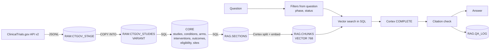

# Architecture

This document covers how the reference build is put together and how the same design grows into a
production clinical-trials assistant. The reference build runs on public registry data only. The
production section describes what changes when real study data is involved.

## Layers

**RAW** keeps every record exactly as the source delivered it, in a `VARIANT` column. Nothing is
parsed on the way in, so any downstream table can be rebuilt from RAW without calling the source
again, and a schema change at the source never breaks ingest.

**CORE** is the normalised trial model, built from RAW with SQL only (`03_core.sql`). One row per
trial in `STUDIES`, one row per list item in the child tables. Dates with month precision
(`2026-01`) are normalised to the first of the month. Eligibility criteria arrive as one free-text
field and are split into inclusion and exclusion text, because "who can join" and "who is ruled out"
are different questions.

**RAG** turns CORE into retrieval units (`04_rag.sql`):

1. Each trial becomes up to five sections by meaning: overview, treatment, inclusion, exclusion,
   outcomes.
2. Each section is split by length with `SPLIT_TEXT_RECURSIVE_CHARACTER` (about 1,400 characters,
   150 overlap, inside the input limit of the embedding model).
3. Every chunk starts with a header line: trial ID, title, phase, status, conditions, section. A
   chunk of exclusion criteria means little without knowing which trial and phase it belongs to.
4. Phases, status and conditions are also stored as columns on the chunk, so filters run in SQL.
5. `EMBED_TEXT_768` computes the vectors inside Snowflake.

## Retrieval

Retrieval is one SQL statement (`rag/retriever.py`): embed the question with Cortex, apply hard
filters, rank, take the top k. Three details carry most of the quality, and `ctrag eval --ablation`
measures each of them:

- The question is embedded with the retrieval instruction the arctic-embed models expect in front
  of queries (documents are embedded without it). On our question set this alone moves trial-level
  hit@5 from 83% to 100%.
- The ranking score is cosine similarity plus a small boost for exact matches on rare terms in the
  question: drug codes such as `SI-B001` or `PLB1004`, gene names such as `SMARCA4`, long drug
  names. Embeddings blur these tokens, and in this domain they are often the whole question.
- Fragments under 120 characters left by the splitter are dropped. They are almost all header,
  rank well on title words and give the model nothing to quote.

Filters are applied before ranking, not after. If a question asks about Phase 3, Phase 1 chunks are
excluded even when their text is closer to the question. This is the main guard against mixing
early-phase safety data with late-phase efficacy data. Phase and recruitment status are read from
the question itself (`rag/filters.py`) and can be overridden explicitly.

**Why plain `VECTOR` columns and SQL rather than Cortex Search.** For a reference build the explicit
version is easier to review, test and reason about: the filters, the similarity function and the
ranking are all visible in one query. Cortex Search Service is the better choice in production
once the corpus grows: it replaces the hand-made keyword boost with proper hybrid ranking, manages
refresh, and supports the same attribute filters. The swap is contained in one class.

## Answers

The prompt (`rag/prompt.py`) asks the model to cite a trial ID after every factual sentence, to say
so when the records do not answer the question, and to keep phases apart.

The model's citations are then checked in code (`rag/citations.py`), not trusted:

| Status | Meaning |
| --- | --- |
| `ok` | every factual sentence cites a trial, and every cited trial was in the retrieved records |
| `uncited_claims` | at least one factual sentence has no citation |
| `unsupported_citations` | the answer cites a trial that was not retrieved |

The status is returned with every answer and stored in `RAG.QA_LOG` together with the question,
filters, the chunk IDs and scores the answer was grounded on, the model and token usage. Any answer
can be traced back to the exact text the model saw.

## Security

- The application signs in as a service user with a key pair. No passwords, nothing interactive.
- The role owns only the `CTRAG` database and can use one extra-small warehouse with auto-suspend.
- Embeddings and generation run in Cortex. Registry text, prompts and answers do not leave the
  Snowflake account.
- Settings and the key path come from the environment. `.env` and key files are git-ignored.

## Production path

The reference build answers questions about the public registry. A production assistant for a
sponsor or CRO works over the study's own data, and most of the design carries over. What changes:

### Sources and flow

Trial data is produced at sites and moves to the sponsor through a few systems, each a source:

| Source | Typical content | Landing in Snowflake |
| --- | --- | --- |
| EDC (for example Medidata Rave, Veeva EDC) | case report form data entered at sites | scheduled exports or vendor shares into RAW |
| Data management outputs | SDTM domains (DM, AE, EX, LB, VS and others), ADaM datasets | files staged and loaded per data cut |
| CTMS | site activation, enrolment by site, visits, deviations | API or export into RAW |
| Documents | protocol and amendments, SAP, IB, informed consent forms | stage plus `PARSE_DOCUMENT`, then the same section and chunk pipeline |
| Public registries | ClinicalTrials.gov, EU CTR | as in this build, for competitive landscape questions |

The RAW, CORE, RAG split stays the same. CORE grows SDTM-shaped tables keyed by study, site and
subject, and the documents feed RAG.

### Two kinds of questions

Document questions ("what does the protocol say about dose modification for grade 3 rash") are
retrieval questions and go through RAG as here. Data questions ("how many subjects at site 104 had a
grade 3 or higher AE after cycle 2") must not be answered from text chunks. They go to a text-to-SQL
path over CORE, for example Cortex Analyst with a semantic model of the SDTM tables, so the number
comes from a query that can be shown and rerun. A small router decides which path a question takes,
and an answer can combine both.

### Versioning

Protocols are amended during a study. Every document chunk carries the protocol version and its
effective dates, and answers say which version they quote. CORE keeps history for slowly changing
entities (site status, protocol version in force) instead of overwriting.

### Incremental loads

Full refresh is fine for a few thousand registry records. In production: Snowpipe or scheduled
`COPY INTO` for new files, `MERGE` into RAW on the business key and last update timestamp, Dynamic
Tables (or Streams and Tasks) for CORE, and re-embedding only chunks whose text changed.

### Access control and privacy

- Row access policies limit each user to the studies and sites they are assigned to. The
  assistant runs with the caller's role, so retrieval cannot return rows the user could not query
  directly.
- Masking policies cover direct identifiers and quasi-identifiers (dates of birth, free-text
  fields that may contain names).
- Subject-level data enters a prompt only when the user's role allows it, and the audit log records
  that it did.

### Evaluation and review

- Question sets written with clinical operations, data management and medical writing, one set per
  use case, with expected sources.
- The evaluation runs in CI against a staging account on every change to prompts, chunking or
  models, with thresholds for retrieval hit rate, citation validity and refusal on unanswerable
  questions.
- Answers with citation problems go to a review queue instead of being shown as final.
- When outputs support regulated decisions, the audit log, prompt and model versions and the
  evaluation history become part of the validation package (computer system validation, 21 CFR
  Part 11 for electronic records). This reference build does not claim any of that.

### Cost

Extra-small warehouse with auto-suspend for queries, resource monitors on Cortex usage, embeddings
computed once per changed chunk, and a cheaper model for routing and query rewriting than for the
final answer.

## Limitations of this reference build

- Public registry data only. No patient-level data, no documents beyond registry text.
- One therapeutic area slice (non-small cell lung cancer, Phase 1 to 3, started 2019 or later, 500
  trials), full refresh on every build.
- The evaluation set is small and was written by us from the records, so it measures whether the
  pipeline finds the right trial, not real-world recall on questions written by clinical teams.
- No user interface. The CLI is the interface.
